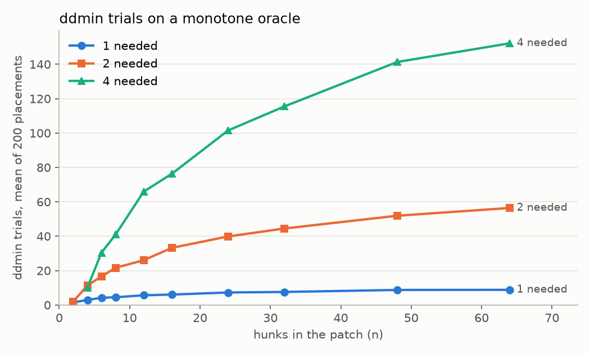

# patchmin

[](https://github.com/vipul21435/patchmin/actions/workflows/ci.yml)

Find the part of a bug fix that actually fixes it. Given a git repository, a fix commit or patch, and a test command, patchmin drops hunks and lines from the fix with delta debugging (Zeller and Hildebrandt, 2002) until every remaining piece is needed for the target tests to pass and the rest of the suite to stay green.

On tabulate commit 8014ec6 ("Fix alignments in `github` tables"), 1 of the 3 non-test hunks and 1 of the 4 lines that hunk adds are enough for the four target tests and the rest of the suite: 22 test runs with `--jobs 4`, 38.0 s on a loaded laptop. The command and five more commits from more-itertools, toolz and attrs are under [Results on real public data](#results-on-real-public-data).

## Why this is hard

A bug-fix commit rarely contains only the fix. It carries docstring edits, renamed variables, reformatting, a changelog line and sometimes a second unrelated change. Reading the diff does not tell you which hunks the failing tests depend on, and trying subsets by hand is slow: a patch with n hunks has 2^n subsets, and every trial is a checkout, an apply and a test run. Test runs are also noisy: a subset may fail to apply because it depends on a hunk that was dropped, a test may be flaky, and a run may hang. The tool has to search the subsets with few runs, treat "did not apply" and "timed out" as a third outcome rather than a failure, never run the same subset twice, and confirm what it reports.

## Install

```
pip install git+https://github.com/vipul21435/patchmin
```

Python 3.10 or newer; no runtime dependencies beyond the standard library and `git` on the `PATH`. For development:

```
uv venv --python 3.12 .venv
uv pip install -e ".[dev]"
uv run pytest -q
```

On 2026-11-06 `uv run pytest -q --cov=patchmin` ran 165 tests, offline, with 98 % line coverage of `src/patchmin` (1101 statements, 27 missed; the tests build their own git repositories in temporary folders). With a 1-minute load average of 7.9 on the laptop, that run took 83 s, and `uv run pytest -q` took 85 s right after it; an earlier run of the suite at a load average of 2.4 took 36 s.

## Quickstart

From a clone (`git clone https://github.com/vipul21435/patchmin && cd patchmin`, then the development install above):

`examples/run_fixture.py` builds a two-commit git repository in a temporary folder: a small `calc.py` with a wrong `add`, then a fix commit of four hunks (a module docstring edit, the real fix together with a comment edit, a function docstring edit, a rewrite of `neg`). It then runs the command line tool on it (all options are listed under [Reference](#reference)). Output of `uv run python examples/run_fixture.py` on 2026-11-06:

```
$ patchmin --repo <repo> --base <base> --fix <fix> --lines \
      --test-cmd 'python -c "import calc; assert calc.add(2, 3) == 5 and calc.mul(2, 3) == 6 and calc.neg(4) == -4"'
not needed  hunk 0   comment    calc.py:1                        +1/-1
needed      hunk 1   code       calc.py:11                       +2/-2  PAD = [
not needed  hunk 2   comment    calc.py:25                       +1/-1  PAD2 = [
not needed  hunk 3   code       calc.py:39                       +1/-1  PAD3 = [
not needed  hunk 1   line 3   -    # adds two numbers
needed      hunk 1   line 4   -    return a - b
not needed  hunk 1   line 5   +    # adds two numbers, now correctly
needed      hunk 1   line 6   +    return a + b
2 of 4 change lines needed
1 of 4 hunks needed; 14 test runs (6 cache hits, 0 flaky, 0 timed out, 0 did not apply) in 0.7s
minimal patch confirmed: pass
```

Every hunk is printed with a status (`needed`, `not needed`, `pinned`) and a kind (`docs`, `test`, `whitespace`, `comment`, `rename`, `code`). The kind is a hint for reading the report; it plays no part in the search.

## How it works

1. **Hunks.** The patch is parsed into hunks, numbered across files. Each `@@` header's line counts decide where its hunk ends, so a mail signature or the next file's `---`/`+++` header is never read as a changed line. The diff is read as bytes and split on `\n` only, so `\r`, form feeds, U+2028 and bytes that are not UTF-8 pass through unchanged. A subset of hunks is rendered back into a unified diff; new-side line numbers are recomputed from the cumulative line delta of the hunks kept before it, so any subset of a file's hunks applies cleanly.
2. **Oracle.** A trial applies the rendered diff with `git apply` in a detached worktree at `BASE` (after `git checkout -- .`, `git clean -fdq` and deleting ignored `__pycache__` directories and `.pyc` files), runs the test command with the targets appended and, if that passes, the rest command. Each command runs in its own process group; on timeout the whole group is killed, so test runners that start workers leave nothing behind. Exit code 0 is a pass, any other code a fail; a diff that does not apply or a command that times out is *unresolved*, which ddmin treats like a fail (the subset is not kept).
3. **Cache.** Every outcome is stored under `SHA-256(base commit id, test command, targets as a JSON list, rest command, rendered diff)`, with a NUL byte after each part; the JSON list keeps a target that contains a space apart from two targets. `--base` is resolved to its full commit id first, so a name such as `HEAD~1` that later points at another commit does not reuse old outcomes. Equal subsets are never run twice, within a search, across the hunk and line passes, or across invocations with `--cache`. A cached timeout is ignored when the current `--timeout` is longer than the one it was recorded with. A cached pass or fail is ignored when it was recorded with fewer `--reruns` than the current run asks for. The file is written to a sibling and renamed, so an interrupted run does not corrupt it.
4. **Flakiness.** With `--reruns K`, a fresh pass or fail is run K more times; if any rerun disagrees, the subset is recorded as flaky and unresolved. The report counts distinct flaky subsets.
5. **Pre-checks.** The full patch must pass and the pinned hunks alone (the empty patch when nothing is pinned) must fail; otherwise the tool says which and stops with exit code 1.
6. **Search.** ddmin, the minimising delta debugging algorithm of Zeller and Hildebrandt, "Simplifying and Isolating Failure-Inducing Input", IEEE Transactions on Software Engineering 28(2), 183-200, 2002 (https://doi.org/10.1109/32.988498). The property kept here is "the target tests pass". Starting with granularity n = 2, the current set is split into n chunks; if some chunk alone passes, it becomes the current set and n resets to 2; otherwise, if the complement of some chunk passes, it becomes the current set and n becomes max(n - 1, 2); otherwise n doubles, up to the size of the set. With two chunks the complements are the chunks themselves and are not tried again. The loop ends when n equals the size of the set and no chunk or complement passes; the result is then 1-minimal: removing any single hunk makes the tests fail. Proposition 12 of the paper bounds the number of trials by n² + 3n for n hunks; the property tests check that bound and 1-minimality on random non-monotone oracles.
7. **Parallel worktrees.** With `--jobs N`, all chunks of one round are run at once, one worktree each, and the first passing one in order is taken. When a round has fewer chunks than N, the free worktrees run the first complements of the same round speculatively; the remaining complements follow only if no chunk and no speculative complement passes. The answer is the same as the sequential search; the parallel search may run subsets that the sequential one would have skipped.
8. **Lines.** With `--lines`, each needed hunk is refined by a second ddmin over its `+` and `-` lines, one hunk at a time with the other needed hunks kept whole. A dropped `+` line disappears and a dropped `-` line turns back into context, so every trial is still a valid diff. Within each run of changed lines the k-th `-` line is paired with the k-th `+` line, and a kept old line is placed where its partner goes: for a two-line replacement `a = 1`, `return a` to `a = 2`, `return a  # now two`, keeping only `+a = 2` gives `a = 1`, `a = 2`, `return a`, and the comment-only line is not needed. `\ No newline at end of file` markers move with their line, so only the last line of each side lacks a newline; `tests/test_line_pairs.py` applies every non-empty line subset of such a hunk and compares the file with the pairing rule; `tests/test_render_subsets.py` checks this with `git apply --check` for every subset of hunks and every non-empty subset of lines in each hunk of a two-file patch with a new file and a deleted file, at 3 and 0 context lines. A hunk that deletes a whole file is kept whole: keeping some of its `-` lines would leave a deleted file with contents, which `git apply` rejects.
9. **Confirmation.** The final minimal patch is run `--confirm` more times, bypassing the cache. This catches a cached pass that was lucky and checks the combined result of the line pass, whose pieces were run one hunk at a time.
10. **Targets.** With `--find-targets`, the test command is run with `--junitxml` (xunit1 family) once with only the pinned hunks and once with the whole patch, limited to the Python files of the pinned hunks. The targets are the tests that pass after the fix and failed (or did not exist) before it: the FAIL_TO_PASS set of SWE-bench ("SWE-bench: Can Language Models Resolve Real-World GitHub Issues?", ICLR 2024, https://arxiv.org/abs/2310.06770; field definitions on https://huggingface.co/datasets/princeton-nlp/SWE-bench). Tests that passed before and fail after are reported as a warning.
11. **Kinds.** `docs` is a hunk in a documentation file, `test` a hunk in a test file, `whitespace` a hunk whose lines are equal once whitespace is removed, `comment` a hunk whose changed lines are `#` comments or sit inside a docstring (the docstring state at the top of the hunk is guessed from the first triple-quote fence), `rename` a hunk whose removed and added lines are the same token for token except for identifiers that map one to one (keywords, `True`, `False`, `None` and builtins such as `min` do not count as identifiers, so `return True` to `return False` is `code`), and `code` anything else.

There are no thresholds on patch size or on the number of hunks, and the tool never grades a fix. A "not needed" label says only that the target tests (and the rest command) pass without that hunk; it does not say the hunk is useless.

### Cost of the search

`examples/ddmin_cost.py` counts the trials ddmin makes when k of n hunks are needed (oracle: "all k are present"), over 200 random placements per point with seed 1. Output of `uv run --with matplotlib python examples/ddmin_cost.py --plot docs/ddmin_cost.png`, mean (max) trials:

| hunks n | k=1 | k=2 | k=4 | n²+3n |
|---|---|---|---|---|
| 4 | 3.0 (4) | 11.4 (16) | 10.0 (10) | 28 |
| 8 | 4.5 (6) | 21.6 (30) | 40.9 (58) | 88 |
| 16 | 6.0 (8) | 33.2 (44) | 76.3 (104) | 304 |
| 32 | 7.6 (10) | 44.5 (58) | 115.5 (149) | 1120 |
| 64 | 8.8 (12) | 56.4 (72) | 152.2 (197) | 4288 |



These are trials, not test runs: ddmin asks about some subsets more than once, and the cache answers the repeats.

### Reference

The general form of the command:

```
patchmin --repo PATH --base COMMIT (--fix COMMIT | --patch FILE) --test-cmd CMD
    [--context N] [--target TEST ...] [--find-targets] [--pin GLOB ...] [--rest-cmd CMD]
    [--lines] [--clean-ignored] [--jobs N] [--reruns K] [--confirm C] [--timeout SECONDS]
    [--cache runs.json] [--json] [--out minimal.diff] [--markdown report.md]
```

| Option | Meaning |
|---|---|
| `--fix` / `--patch` | the fix as a commit (the patch is `git diff BASE FIX`) or as a unified diff file (`git diff`, `git format-patch` or `diff -u`/`diff -ru` output) |
| `--context N` | context lines for `git diff` with `--fix` (default 3); `0` gives one hunk per run of adjacent changed lines, applied with `git apply --unidiff-zero` |
| `--test-cmd` | the test command; `--target` values are appended to it |
| `--find-targets` | pytest only: run the tests before and after the fix and use the tests that fail before and pass after as the targets |
| `--pin GLOB` | hunks in matching files are applied in every trial and never searched (typically the test files of the fix) |
| `--rest-cmd` | a second command that must also pass for a subset to count, so the rest of the suite stays green |
| `--lines` | after the hunk search, minimise the `+`/`-` lines inside each needed hunk |
| `--clean-ignored` | delete every ignored file between trials (`git clean -X`); by default only ignored `__pycache__` directories and `.pyc` files are deleted |
| `--jobs N` | run up to N subsets at once, each in its own git worktree (default 1) |
| `--reruns K` | run every fresh outcome K more times; disagreement marks it flaky (default 0) |
| `--confirm C` | run the final minimal patch C more times without the cache (default 1); exit code 2 if any of them fails |
| `--timeout` | seconds per command (default 600); a run that hits it is unresolved |
| `--cache FILE` | keep outcomes in a JSON file, so a second invocation reuses them |
| `--json`, `--out` | print the result as JSON; write the minimal patch as a diff that `git apply` accepts on `BASE` |
| `--markdown FILE` | write a Markdown report: counts, one row per hunk, the line verdicts and the minimal patch |

Exit codes: 0 when the minimal patch is found (and confirmed), 2 when a confirming run fails, 1 on an error. A `--repo` that is not a git work tree, a `--base` or `--fix` that names no commit, a missing `--patch` file, a `--test-cmd` or `--rest-cmd` with unbalanced quotes, or a `--cache` file that is not JSON stops the run before any test runs, with one `error:` line on stderr; errors found later (a failed pre-check, no targets found) also go to stderr; negative counts, `--jobs 0`, a non-positive `--timeout` and a missing required flag are rejected by the argument parser, also with exit code 1. A test program that does not exist makes the run unresolved with the reason `command not found`, and such runs are not cached.

From Python (`uv run python examples/python_api.py`, abridged output below the code):

```python
from patchmin import RunCache, WorktreeOracle, minimize_text

with WorktreeOracle(repo, base, test_cmd, cache=RunCache(), jobs=2) as oracle:
    result = minimize_text(diff, oracle, lines=True, confirm=1)
print(result.needed, result.runs, result.cached_hits, result.confirmed)
print(result.minimal_patch)
```

```
needed hunks: [1]
kinds: [(0, 'comment', 'not needed'), (1, 'code', 'needed'), (2, 'comment', 'not needed'), (3, 'code', 'not needed')]
runs: 19 cache hits: 6 confirmed: True
@@ -11,8 +11,8 @@ PAD = [
 ]

 def add(a, b):
     # adds two numbers
-    return a - b
+    return a + b
```

With `jobs=2` the run count is 19 rather than the 14 of the sequential command above: each parallel round runs every chunk of the round.

## Results on real public data

Six bug-fix commits from four small pure-Python libraries, chosen because the fix commit carries more than the fix (a README, changelog or changelog-fragment edit, a docstring line, a removed block or import, several code hunks). For each, the targets are the tests that fail before the fix and pass after; they were found by hand (applying the commit's test files to the parent and running pytest), and for the first three `--find-targets` returns the same lists. The test files are pinned; the whole test suite is the rest command.

| Library | Commit | Fix |
|---|---|---|
| tabulate | `8014ec6` (2026-03-05) | Fix alignments in `github` tables |
| tabulate | `3aa568c` (2026-03-05) | fix #408 - remove trailing whitespace from asciidoc output |
| more-itertools | `ce676d2` (2026-09-04) | Do not yield an empty list for an empty iterable when maxsplit is 0 |
| toolz | `d2eba03` (2026-09-18) | Fix interpose([]) raising StopIteration |
| attrs | `af9c510` (2026-03-14) | Fix validators.disabled() to save/restore state on nesting |
| attrs | `ce89f5d` (2026-03-14) | Fix message passing in frozen errors |

Command (one laptop with 8 cores, 2026-11-06, Python 3.12.13, pytest 9.2.0, hypothesis 6.170.15):

```
bash examples/reproduce_real_commits.sh DATA_DIR
```

It clones the four repositories into `DATA_DIR`, makes a Python 3.12 environment there with pinned pytest, hypothesis, pympler and cloudpickle (the attrs test dependencies), runs `uv run python examples/real_commits.py --data DATA_DIR --python DATA_DIR/venv312/bin/python --jobs J --out results/jobsJ` for J = 1 and 4, and prints the table and the hunk list below (`uv run python examples/real_commits.py --summary results/jobs1 results/jobs4` and `--hunks results/jobs4` print them again from the saved JSON). For each case `real_commits.py` runs `patchmin --base C^ --fix C --pin 'TESTS/*' --test-cmd 'PY -m pytest -q -p no:cacheprovider' --target ... --rest-cmd 'PY -m pytest -q -p no:cacheprovider TESTS' --lines --jobs J --reruns 1 --confirm 2 --json`. Two changes per library: attrs keeps its code under `src/` and imports tests with `--import-mode=importlib`, so both commands get `-o pythonpath=src`; and the clones are not installed, so the tests that read installed package metadata are left out of the rest command (`--ignore tests/test_packaging.py` for attrs, `--deselect toolz/tests/test_package.py::test_has_version` for toolz; they fail before and after each fix). The whole script took 25 min 14 s.

| commit | jobs | hunks needed | lines needed | ddmin trials | test runs | cache hits | flaky | unresolved | confirm | wall s |
|---|---|---|---|---|---|---|---|---|---|---|
| tabulate 8014ec6 | 1 | 1 of 3 | 1 of 4 | 7 | 20 | 0 | 0 | 0 | pass, pass | 34.4 |
| tabulate 8014ec6 | 4 | 1 of 3 | 1 of 4 | 8 | 22 | 0 | 0 | 0 | pass, pass | 38.0 |
| tabulate 3aa568c | 1 | 1 of 3 | 5 of 5 | 24 | 42 | 6 | 0 | 0 | pass, pass | 46.2 |
| tabulate 3aa568c | 4 | 1 of 3 | 5 of 5 | 24 | 42 | 6 | 0 | 0 | pass, pass | 30.5 |
| more-itertools ce676d2 | 1 | 3 of 4 | 12 of 12 | 43 | 84 | 4 | 0 | 0 | pass, pass | 471.2 |
| more-itertools ce676d2 | 4 | 3 of 4 | 12 of 12 | 46 | 90 | 4 | 0 | 0 | pass, pass | 437.8 |
| toolz d2eba03 | 1 | 1 of 1 | 5 of 7 | 30 | 46 | 10 | 0 | 0 | pass, pass | 37.6 |
| toolz d2eba03 | 4 | 1 of 1 | 5 of 7 | 38 | 62 | 10 | 0 | 0 | pass, pass | 22.8 |
| attrs af9c510 | 1 | 1 of 2 | 2 of 4 | 16 | 26 | 6 | 0 | 0 | pass, pass | 86.5 |
| attrs af9c510 | 4 | 1 of 2 | 2 of 4 | 20 | 34 | 6 | 0 | 0 | pass, pass | 72.0 |
| attrs ce89f5d | 1 | 1 of 2 | 4 of 6 | 33 | 52 | 10 | 0 | 0 | pass, pass | 159.8 |
| attrs ce89f5d | 4 | 1 of 2 | 4 of 6 | 36 | 58 | 10 | 0 | 0 | pass, pass | 76.4 |

"Hunks needed" counts the hunks searched (pinned test hunks excluded). "Test runs" includes the two pre-checks, the reruns (`--reruns 1` doubles every fresh run) and the two confirmation runs. "Flaky" is the number of subsets whose rerun disagreed and "unresolved" the number of subsets that were flaky, timed out or did not apply; both are 0 in every run. The verdicts are the same with one and four jobs; four jobs run more subsets because a parallel round runs every chunk of the round, including those after the first passing one. The laptop was running other work: the 1-minute load average read at the end of each case was between 5.1 and 9.4 (saved as `load_average` in each JSON file), and the three tabulate and more-itertools cases took 2.1 to 3.3 times as long as in the earlier runs below, with the same verdicts; with four jobs they also gave the same trial, run and cache-hit counts as before, and with one job more-itertools again took 43 trials and 84 runs.

Hunks and verdicts (`uv run python examples/real_commits.py --hunks results/jobs4`; the same for `results/jobs1`):

```
tabulate 8014ec6
  hunk 0  not needed  docs        README.md:233  +2/-2
  hunk 1  not needed  code        tabulate/__init__.py:522  +0/-10
  hunk 2  needed      code        tabulate/__init__.py:719  +4/-0  lines 1 of 4 needed
  hunks 3-6 pinned    test        test/test_output.py
tabulate 3aa568c
  hunk 0  not needed  docs        README.md:502  +4/-4
  hunk 1  not needed  code        tabulate/__init__.py:278  +4/-2
  hunk 2  needed      code        tabulate/__init__.py:293  +3/-2  lines 5 of 5 needed
  hunks 3-5 pinned    test        test/test_output.py, test/test_regression.py
more-itertools ce676d2
  hunk 0  not needed  docs        docs/versions.rst:10  +1/-0
  hunk 1  needed      code        more_itertools/more.py:1618  +3/-1  lines 4 of 4 needed
  hunk 2  needed      code        more_itertools/more.py:1654  +3/-1  lines 4 of 4 needed
  hunk 3  needed      code        more_itertools/more.py:1694  +3/-1  lines 4 of 4 needed
  hunks 4-7 pinned    test        tests/test_more.py
toolz d2eba03
  hunk 0  needed      code        toolz/itertoolz.py:522  +6/-1  lines 5 of 7 needed
  hunk 1  pinned      test        toolz/tests/test_itertoolz.py:255  +4/-0
attrs af9c510
  hunk 0  not needed  docs        changelog.d/1513.change.md:0  +1/-0
  hunk 1  needed      code        src/attr/validators.py:79  +3/-1  lines 2 of 4 needed
  hunk 2  pinned      test        tests/test_validators.py:97  +16/-0
attrs ce89f5d
  hunk 0  not needed  code        src/attr/exceptions.py:2  +0/-2
  hunk 1  needed      code        src/attr/exceptions.py:16  +4/-2  lines 4 of 6 needed
  hunk 2  pinned      test        tests/test_functional.py:264  +10/-3
```

(The pinned test hunks are folded into one line per case here; the script prints one line per hunk.) `:0` is the line number of a new file.

What the minimal subsets show:

- **tabulate 8014ec6.** The fix deletes the old `"github"` entry from the format table (10 lines) and adds, after the table, `_table_formats["github"] = _table_formats["pipe"]`. Only the added assignment is needed: it overrides the old entry, so the deletion is not needed for the tests, and the README hunk is not needed. The line pass keeps 1 of the 4 added lines; the two comment lines and the blank line go.
- **tabulate 3aa568c.** Of the two hunks in `_asciidoc_row`, only the second is needed: it strips the line built for header and data rows, which is where the trailing whitespace came from. The first adds `.rstrip()` to the `[cols=...]` / `|====` line and to the above-line branch; that text ends in `|====`, so stripping it changes nothing the tests see, and the targets and the full suite pass without it. Every line of the needed hunk is needed.
- **more-itertools ce676d2.** All three code hunks (`split_before`, `split_after`, `split_when`) are needed, each by its own target test, and every line inside them; only the changelog line in `docs/versions.rst` is not needed.
- **toolz d2eba03.** The fix and a new doctest example in the docstring of `interpose` are two lines apart, so with three context lines they form one hunk, and the hunk search can only call it needed. The line pass separates them: the two added doctest lines (`>>> list(interpose("a", []))` and `[]`) are not needed. An added doctest is a test, not code: dropping it can only remove a check, so it is never needed for the tests to pass, whether or not the rest command runs doctests (this one does not; the toolz CI runs `pytest --doctest-modules`). The `try`/`except StopIteration` lines and the removed bare `next(inposed)` are.
- **attrs af9c510.** The changelog fragment (a new file) is not needed. In `disabled()`, `prev = get_run_validators()` and `set_run_validators(prev)` are needed; the added `.. versionchanged::` docstring line is not, and neither is the removal of the old `set_run_validators(True)`: when that line stays, the `finally` block first sets `True` and then `prev`, which ends in the same state.
- **attrs ce89f5d.** The first hunk removes `from typing import ClassVar`, which the new code no longer uses; it is not needed. In the second hunk, the new `__init__` that passes the message to `super().__init__` and the removal of the `args: ClassVar[...]` class attribute are needed; `self.msg = msg` and the removal of the class attribute `msg = "can't set attribute"` are not, because the kept class attribute already gives `e.value.msg` the same value.

Across the six commits, the hunks and lines found not needed are of four kinds: release notes and documentation (two README hunks, a `docs/versions.rst` line, a `changelog.d` fragment); text in the code that the tests do not execute (a `.. versionchanged::` docstring line, two comment lines and a blank line) or that is itself a test (an added doctest example); cleanup that the fix made possible but does not depend on (an import left unused, an old dict entry and an old class attribute that the new code overrides); and changes whose effect the tests cannot see (`.rstrip()` on text that has no trailing whitespace, a removed `set_run_validators(True)` followed by the new call). The first two kinds are expected; the last two are where reading the minimal patch tells you something, and they also show what "not needed" means here: the tests pass without it, not that it should be dropped from the fix.

Parallel worktrees. Earlier runs of the first three cases with `--jobs 1`, `4` and `8` (and `--out OTHER_DIR`), seven runs in all on the same laptop on 2026-11-06, while other work was running (the 1-minute load average at the start of each run is given). Wall seconds:

| run | jobs | load | tabulate 8014ec6 | tabulate 3aa568c | more-itertools ce676d2 |
|---|---|---|---|---|---|
| first | 1 | not recorded | 12.8 | 14.7 | 199.2 |
| first | 4 | not recorded | 11.8 | 10.2 | 180.5 |
| repeat | 4 | 5.1 | 17.1 | 15.6 | 275.8 |
| repeat | 8 | 3.7 | 12.1 | 10.3 | 179.5 |
| repeat | 1 | 2.6 | 13.2 | 13.9 | 221.2 |
| rerun | 4 | 30.6 | 13.7 | 11.6 | 263.0 |
| rerun after fixes | 4 | 4.7 | 14.3 | 12.3 | 204.1 |

All of these gave the same verdicts as the table above. On this machine the noise between repeats (180.5 s and 275.8 s for the same command) is larger than the gain from parallel worktrees on the first three cases. In the main table, four jobs were faster for the two attrs commits (86.5 to 72.0 s and 159.8 to 76.4 s) and for toolz (37.6 to 22.8 s), slower for tabulate 8014ec6 (34.4 to 38.0 s), from one run each under a changing load, so they show at most that parallel worktrees can help when the rest command is a few seconds long. Two limits in the search itself: with few hunks a round has few chunks, so few worktrees are busy, and every passing subset also runs the whole suite as the rest command (about 11 s for more-itertools, 5 to 14 s for attrs) inside its own worktree.

Data: tabulate and more-itertools were cloned from the source links on https://pypi.org/project/tabulate/ and https://pypi.org/project/more-itertools/, toolz from https://github.com/pytoolz/toolz (the `homepage` link on https://pypi.org/project/toolz/) and attrs from https://github.com/python-attrs/attrs (the `GitHub` link on https://pypi.org/project/attrs/); the script resolves each clone URL from PyPI. Licences, each checked on the repository's own licence file on 2026-11-06: tabulate and more-itertools MIT; attrs MIT (https://github.com/python-attrs/attrs/blob/main/LICENSE); toolz BSD 3-clause (https://github.com/pytoolz/toolz/blob/master/LICENSE.txt). Nothing from them is stored in this repository except the short hunk headings and changed lines inside `results/jobs1/*.json` and `results/jobs4/*.json`.

## Limitations

- 1-minimal is not globally minimal: a different, smaller subset may exist that ddmin does not find. The line pass is 1-minimal within each hunk, given the other needed hunks; a line needed only together with a line in another hunk is kept.
- A subset that does not apply counts as unresolved, which can keep a hunk the fix does not strictly need when a later hunk's context overlaps it. Hunks are not split or re-anchored after parsing; `--context 0` gives smaller hunks from the start.
- The isolation algorithm of the same paper (dd, which narrows the difference between a passing and a failing configuration) is not implemented; only ddmin is.
- `--find-targets` works with pytest only, and maps junit entries to node ids from the class name (the longest dotted prefix that names a `.py` file in the worktree is the module, so inherited test methods keep their own class); parametrised ids are kept as pytest writes them. Other test runners need `--target`.
- Test commands are split with `shlex` and run without a shell: pipes, redirection and environment assignments in the command are not supported (wrap them in a script).
- The environment is whatever the given interpreter has: the tool does not install the project or its dependencies, and does not isolate runs from each other beyond separate worktrees.
- Between trials in one worktree, tracked files are restored and untracked files deleted, but ignored files persist (build output, tool caches), except Python bytecode: ignored `__pycache__` directories and `.pyc` files are deleted, and test commands run with `PYTHONDONTWRITEBYTECODE=1`, because CPython would otherwise trust a `.pyc` left by a previous trial after a same-size edit made within the same second. `--clean-ignored` deletes every ignored file instead.
- Kinds are heuristics read from the diff alone; a hunk wholly inside a long docstring with no fence in view is labelled `code`.
- With `--jobs` above 1, test runs share the machine: tests that write to fixed paths outside the worktree, bind fixed ports or rely on timing can interfere with each other.
- Wall times in this README were measured on a laptop that was running other work at the same time; repeats of the same command differ by tens of percent, and by a factor of 2 to 3 between runs at different loads (see the results section).
- Hunks come from `git diff` context: a fix line and an unrelated line (a docstring example, a comment) within a few lines of each other form one hunk, and only `--lines` or `--context 0` separates them (toolz `d2eba03` above).
- "Not needed" is decided by the tests alone: a removed line whose effect a new line overrides, a cleanup the fix made possible and a change the tests do not observe are all reported as not needed (attrs `af9c510` and `ce89f5d`, tabulate `8014ec6` and `3aa568c` above). The minimal patch is a statement about the tests, not a better fix.
- Tests that need the project installed (package metadata, entry points) fail in a plain clone; the real-commit runs leave them out of the rest command.
- Renames: `--fix` diffs with `--no-renames`, so a renamed file is searched as a deletion plus an addition. A `--patch` file that contains a rename or copy, or a binary change, stops with an error before any test runs (make it with `git diff --no-renames`; binary changes are not supported at all). File entries with no hunks (a new or deleted empty file, a mode change) and the mode change of a file whose hunks are all dropped are applied in every trial and get no verdict. Process-group killing on timeout assumes a POSIX system.
- The cache key covers the base commit id, the commands, the targets and the patch text, not the environment: untracked files in the repository, the interpreter and the installed packages are not part of it. Delete the `--cache` file after changing any of them. The repository path is not part of the key either; the same commit id names the same tracked content in any clone.
- In the line pass, a hunk that deletes a whole file is all or nothing; its lines are reported as needed without a search. Lines are paired by position within a run of changed lines (k-th `-` with k-th `+`), not by content, so when a replacement block also inserts or deletes lines the pairing can place a kept old line away from the new line it corresponds to; the line pass may then keep an extra line.
- Flaky detection only sees disagreement within the reruns requested; with `--reruns 0` a flaky test can mislead the search, and only the confirmation runs may reveal it.

## Related tools

- [commitminer](https://github.com/vipul21435/commitminer): mine and rank candidate tasks from repository history.
- [reporewind](https://github.com/vipul21435/reporewind): resolve Python fix commits into source and test patches.
- [taskledger](https://github.com/vipul21435/taskledger): schema validation and lint rules for benchmark-task bundles.
- [graderguard](https://github.com/vipul21435/graderguard): audit graders for reward hacking and flakiness.
- [patchsim](https://github.com/vipul21435/patchsim): how far textual similarity to the gold patch goes as a proxy for correctness, checked against test outcomes.
- [awesome-coding-agent-evals](https://github.com/vipul21435/awesome-coding-agent-evals): a curated list of benchmarks, harnesses, datasets and papers for coding agents, each checked at its source.

## Licence

MIT, see `LICENSE`.

Built by Vipul Raj Jha · https://vipul21435.github.io
